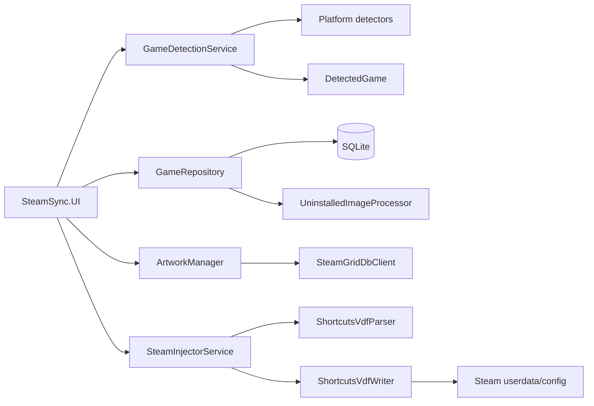

# 01 — Big picture

## What SteamSync is

SteamSync is a Windows desktop application built with .NET 9 / C# that:

1. discovers games from several third-party launchers and custom directories,
2. normalizes them into one model,
3. optionally resolves titles and artwork,
4. stores local state in SQLite,
5. writes Non-Steam entries into Steam's binary `shortcuts.vdf`,
6. writes grid/hero/logo/icon assets into Steam's grid directory,
7. optionally restarts Steam to make changes take effect.

Current stack visible in the repository:

| Area | Implementation |
|---|---|
| Runtime | .NET 9, Windows target |
| Language | C# 13 syntax/features in a .NET 9 project |
| Desktop UI | Avalonia |
| UI pattern | MVVM with CommunityToolkit.Mvvm |
| Persistence | Microsoft.Data.Sqlite |
| Artwork | SteamGridDB API + Steam CDN fallback |
| Image processing | SixLabors.ImageSharp |
| Binary Steam file format | custom VDF parser/writer |
| Testing | xUnit |
| External reference | BoilR git submodule |
| Build entry | `SteamSync.sln` |

See:
- [Core project](../src/SteamSync.Core/SteamSync.Core.csproj)
- [UI project](../src/SteamSync.UI/SteamSync.UI.csproj)
- [Solution](../SteamSync.sln)
- [BoilR submodule](../.gitmodules)

## Architecture

## Central design idea

The system deliberately separates **finding games** from **projecting games into Steam**.

A detector only needs to answer:

> "Here are the games I can find in this source."

The rest of the system can then treat every source the same way.

That is why `IGameDetector` is important.

## What crosses module boundaries

The common object is `DetectedGame`. It carries:

- title/platform
- ownership/install status
- executable path
- working directory
- launch arguments
- generated Steam AppID
- SteamGridDB ID
- artwork cache state
- VR state
- last sync time
- transient UI selection

This is the most important model to understand because it appears in detection, persistence, artwork, Steam injection, tests, and UI bindings.

## State model

SteamSync keeps two concepts independent:

- `IsOwned`
- `IsInstalled`

This enables an important feature: showing games that are owned but not installed.

An uninstalled game may not have a real game executable. Before it can be imported into Steam, `UninstalledImageProcessor` creates a launcher-oriented representation so Steam has something to invoke.

## Why the architecture is easy to extend

A new detector mostly needs:

1. implement `IGameDetector`,
2. create `DetectedGame` objects,
3. register it from `GameDetectionService.ConfigureDefaults`.

The Steam side does not need to know which launcher produced the game.

## Study checkpoint

Be able to answer:

- Why not let every detector write directly to Steam?
- Why is `DetectedGame` central?
- Why are ownership and installation separate?
- Why is Steam injection downstream of detection?
